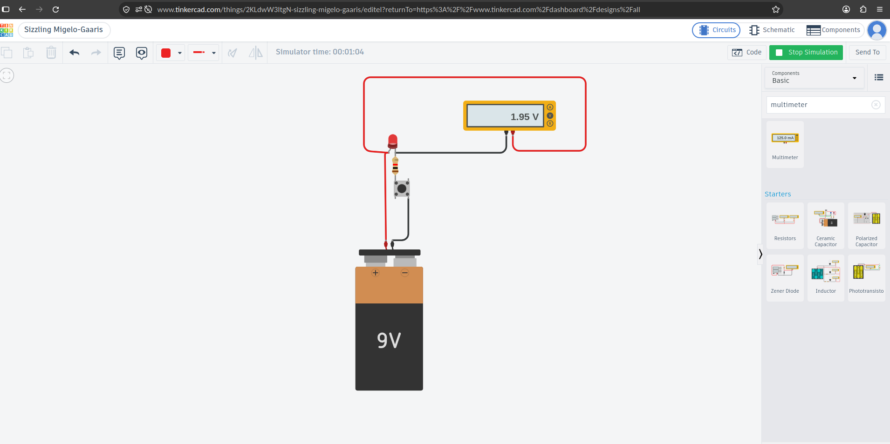

# led-button-circuit

# LED + Button Circuit

A basic circuit where pressing a push button lights up an LED.
Built and simulated in Tinkercad Circuits.
[Try the circuit in Tinkercad](https://www.tinkercad.com/things/2KLdwW3ItgN-sizzling-migelo-gaaris?sharecode=o-kZbTK9Xcv2AtADlraCc8kpvuL8bcPVWxT9LBIiods)

## Parts
- 9V battery
- Red LED
- 1K resistor
- Push button

## How it works
Pressing the button closes the circuit, so current flows from
the battery through the resistor and LED and back to the battery.
The 1K resistor limits the current to about 7 mA, which keeps
the LED safe on 9V.

## What I learned
- **Direction matters:** The long leg (anode) goes to the positive
  terminal and the short leg (cathode) to the negative. If it is
  backwards, the LED will not light.
- **Measurement:** On 9V I used a 1K ohm resistor, because 9V is too
  high for the LED alone. The voltage across the LED is 1.95V, so the
  resistor handles the other ~7V, giving about 7mA.
- Voltage is measured across a part, current in series with it.
